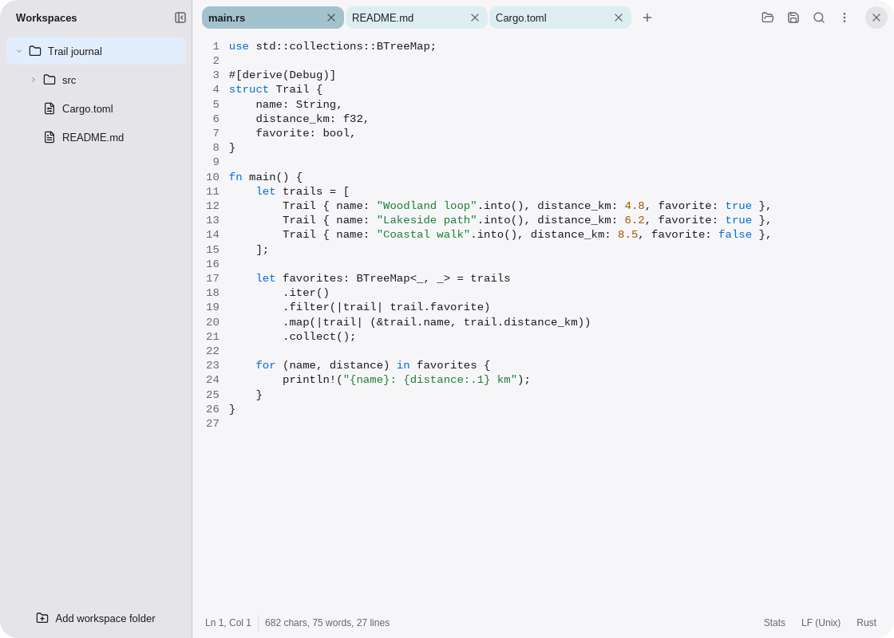
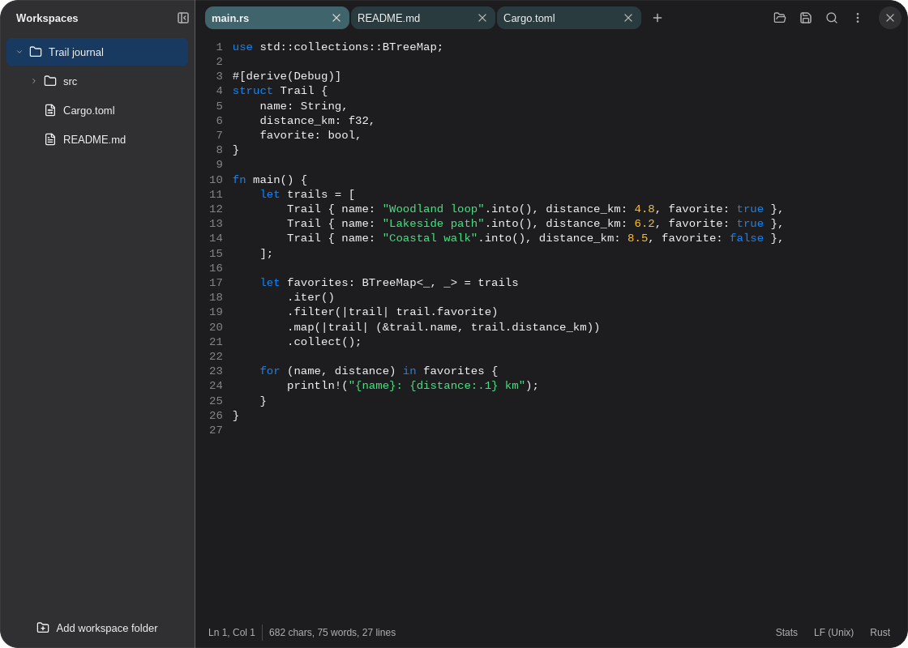
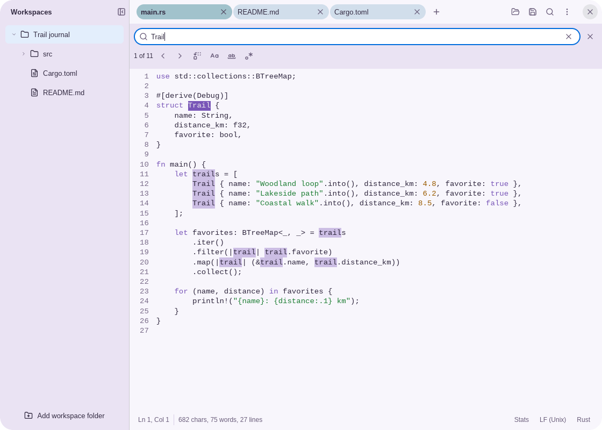
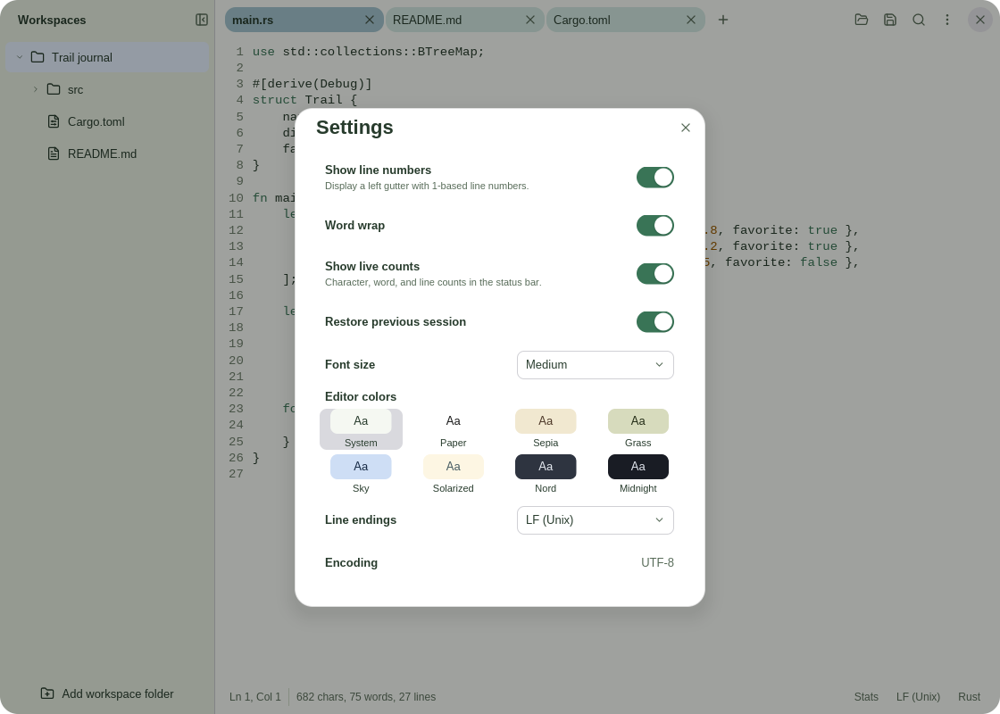
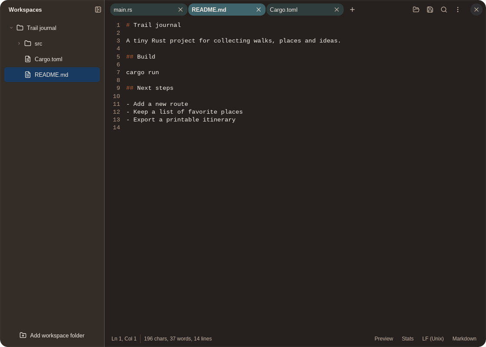
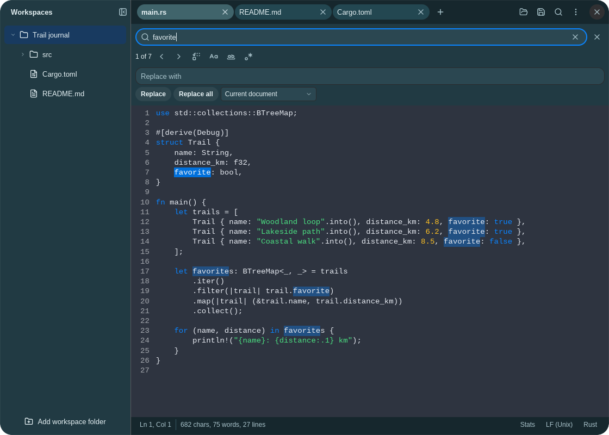
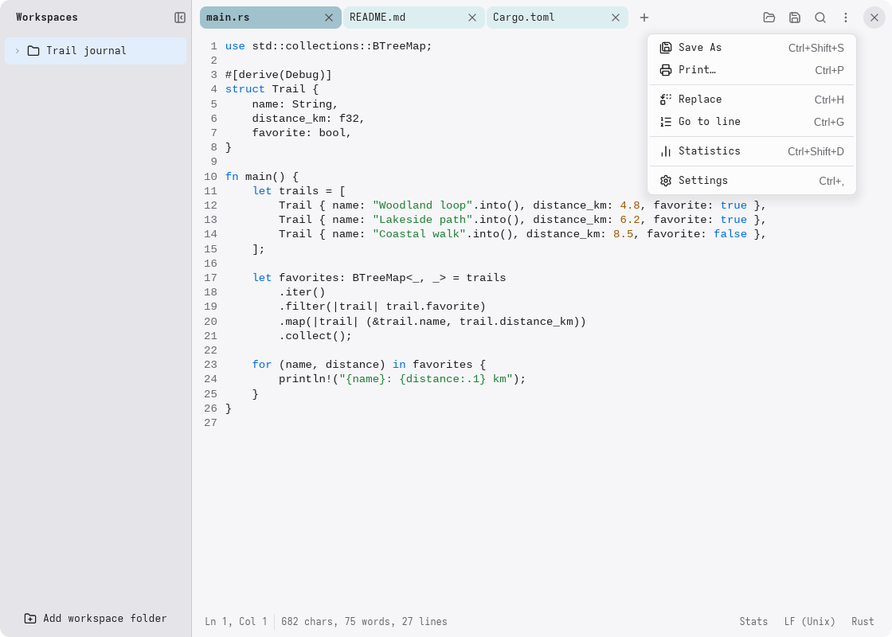
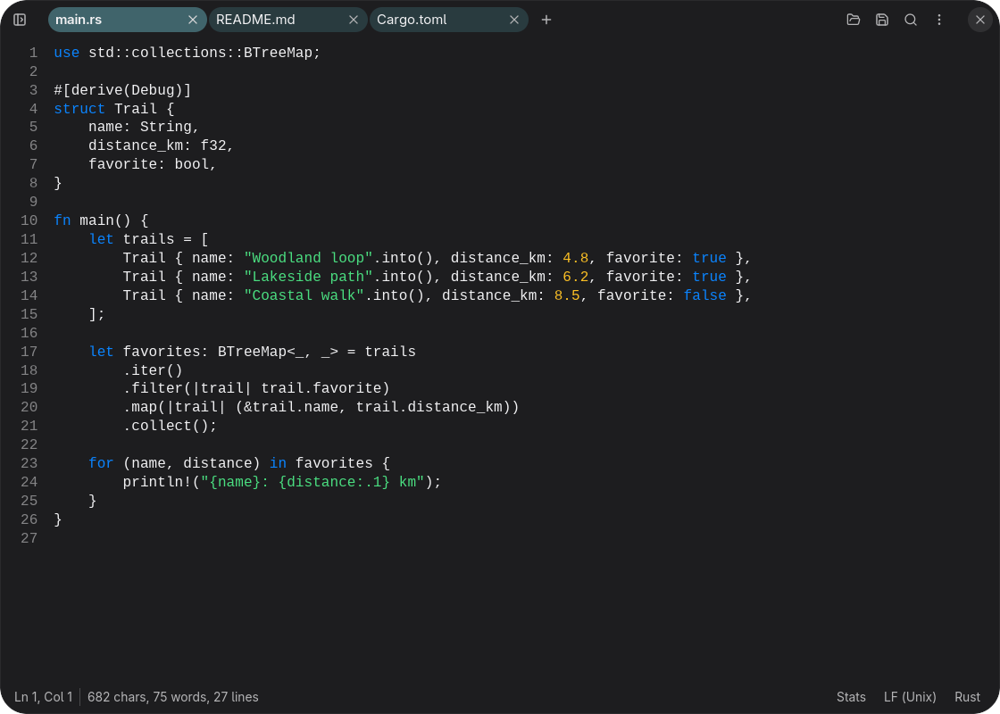

# Text

Edit plain text and source files in a native tabbed editor. Built with [enzUI](https://github.com/enz1m/enzui).

<table>
  <tr>
    <td align="center"><a href="docs/screenshots/basic-light.png"></a><br><sub>Rust · light</sub></td>
    <td align="center"><a href="docs/screenshots/basic-dark.png"></a><br><sub>Rust · dark</sub></td>
    <td align="center"><a href="docs/screenshots/lavender.png"></a><br><sub>Find</sub></td>
    <td align="center"><a href="docs/screenshots/sage.png"></a><br><sub>Preferences</sub></td>
  </tr>
  <tr>
    <td align="center"><a href="docs/screenshots/ember.png"></a><br><sub>Markdown</sub></td>
    <td align="center"><a href="docs/screenshots/lagoon.png"></a><br><sub>Replace</sub></td>
    <td align="center"><a href="docs/screenshots/precision.png"></a><br><sub>Actions</sub></td>
    <td align="center"><a href="docs/screenshots/comfort.png"></a><br><sub>Sidebar hidden</sub></td>
  </tr>
</table>

Click a screenshot to enlarge. Images use isolated example data and shared enzUI themes.

## Features

- Tabs, workspace folders and syntax highlighting.
- Find/replace, go to line, printing and file activation.
- Atomic saves, restored sessions and unsaved-document recovery.

## Build and run

Use Rust **1.99.1** (minimum **1.95**), a C/C++ toolchain and pkg-config.
Linux UI builds need Wayland/XKB, GLib/GIO, fontconfig and Vulkan/EGL development support.

```sh
git clone https://github.com/enz1m/text.git
cd text
cargo build --locked
cargo run --locked
```

Dependencies pin public [enzUI source](https://github.com/enz1m/enzui)
and its matching public foundation forks. No sibling framework checkout is needed.
Wayland is enabled by default; use `--features x11` when X11 support is needed.
Use `cargo build --release --locked` for an optimized binary.

## Files and desktop integration

Open plain text, Markdown, source files, JSON, TOML, YAML, XML and other text formats. Command-line paths and file URIs target the existing window. Files are edited in place only after an explicit save.

## Requirements and limits

Text preserves unsaved drafts and reports failed writes. Very large documents use bounded editing/restore paths. Printing and native file dialogs depend on host portal/printer support.

Shared enzUI theme settings apply live. Translations are under `assets/locales`;
locale coverage varies.

## Development

```sh
cargo fmt --all -- --check
ICED_TEST_BACKEND=software cargo test --locked --all-targets -- --test-threads=1
cargo clippy --locked --all-targets -- -D warnings
```

Keep tests for durable workflows, data integrity, resource ownership and security
boundaries. See [contributing](CONTRIBUTING.md).

Licensed under [MIT](LICENSE); retained dependency notices and licenses apply to
third-party code and assets.
